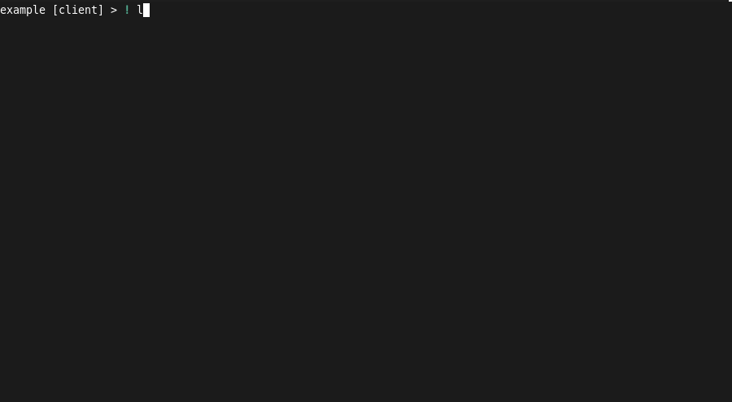
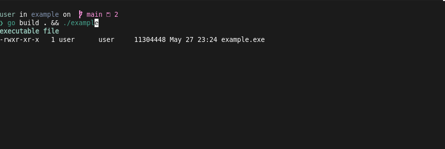

> **Runnable example:** [`cmd/macros`](../cmd/macros)

## Emacs mode

When using emacs editing mode, the default binds for recording/running/printing a macro are:

- "C-X("    `start-kbd-macro`  
- "C-X)"    `end-kbd-macro`  
- "C-XE"    `call-last-kbd-macro`  

Note that neither `start-kbd-macro` nor `call-last-kbd-macro` accept an argument key
for selecting which macro identifier will store/run the macro. If you want such
functionality, you should bind one of the Vim-style macro commands described in 
the next section instead.

Below is an example of recording and running a macro in Emacs mode:
- List the contents of a target directory.
- Start recording a macro with `Ctrl-X`-`(`
- Type `! cd `
- Use `\M-.` to insert the last word from the last command entered, and press `Enter`.

## Vim mode

Two additional macro commands have been implemented in this library, so as to enable
Vim-style macro recording and invocation. The binds are as follows:

**Command mode**   
- "q"  `macro-toggle-record`    
- "@"  `macro-run`    
**Insert mode**    
- "M-q"   `macro-toggle-record`    
- "M-@"   `macro-run`    

Both commands will read a key from the keyboard, which will be used as 
the letter ID in which to store the macro (before recording), or invoke it.
A call will thus look like `qa` for recording the macro stored in `a`, and
`@a` to run this macro.

Below is the same example in Vim-mode:
- Type a command with a flag accepting a list of files.
- Get in command mode.
- Type `qw` to start recording a macro that will stored in `w`.
- Go to beginning of line with `0`, then go to the start of the flag
- Select it with `vE`, and change it with `c` and typing the new flag.
- Type `q` to end the macro recording.
- Change the flag name again.
- Type `@w` to invoke the macro, setting the flag to `--path` once again.

