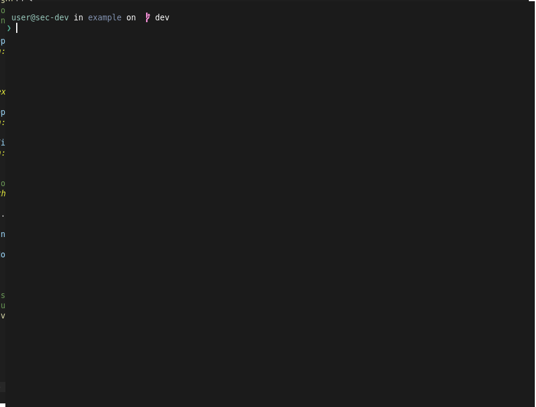

> **Runnable example:** [`cmd/prompts`](../cmd/prompts)

# Table of Contents

<details>
<summary>Click to expand Table of Contents</summary>
<ul>
        <li><a href="#table-of-contents">Table of Contents</a></li>
        <li><a href="#prompt-handlers">Prompt handlers</a></li>
        <li><a href="#logging-to-the-shell">Logging to the shell</a><ul>
            <li><a href="#transient-log">Transient log</a></li>
            <li><a href="#classic-prompt-log">Classic prompt log</a></li>
            <li><a href="#demo">Demo</a></li>
        </ul></li></ul></li>
</ul>
</details>

Readline supports most of the prompts offered by [Oh-My-Posh](https://github.com/JanDeDobbeleer/oh-my-posh), namely:
- `$PS1` - the primary prompt.
- `$PS2` - the secondary prompt.
- `RPROMPT` - The right prompt, (which is not to be confused with a right-aligned primary prompt)
- `Tooltip` - A prompt being refreshed at every key input in the line (see the [`cmd/prompts`](../cmd/prompts) example).
- `Transient` - A prompt being printed in place of `PS1` after command/line execution.

Additionally, readline supports those prompts for any valid oh-my-posh configuration. 


## Prompt handlers

The following functions are available to bind prompt handlers.
```go
func (p *Prompt) Primary(prompt func() string)
func (p *Prompt) Right(prompt func() string)
func (p *Prompt) Secondary(prompt func() string)
func (p *Prompt) Transient(prompt func() string)
func (p *Prompt) Tooltip(prompt func(word string) string)
```

An example of using the prompt handlers:
```go
func (prompt *Prompt) bind(shell *readline.Shell) {
    
    // The oh-my-posh prompt engine, with a loaded configuration. 
    p := prompt.Engine
        
    shell.Prompt.Primary(p.PrintPrimary)
    shell.Prompt.Right(p.PrintRPrompt)

    // Secondary prompt.
    secondary := func() string {
        return p.PrintExtraPrompt(engine.Secondary)
    }
    shell.Prompt.Secondary(secondary)

    // Transient prompt (never nil, but enabled with the readline configuration file)
    transient := func() string {
        return p.PrintExtraPrompt(engine.Transient)
    }
    shell.Prompt.Transient(transient)

    shell.Prompt.Tooltip(p.PrintTooltip)
}
```

## Logging to the shell

The shell offers two methods to print output with different behavior.

### Transient log
The first method will actually "push" the prompt below a log line to be printed. In detail,
the current prompt/line/helpers are cleared, the log output is printed, and the prompt/line
is redisplayed below it.

```go
func (rl *Shell) PrintTransientf(msg string, args ...any)
```

### Classic prompt log

There may be some cases, though, where you want the current prompt to be left as is,
your log event to be printed below it, and a new prompt/input line to be displayed below.
For this, the following method is given:
```go
func (rl *Shell) Printf(msg string, args ...any)
```

### Demo
The following shows a ticker printing 6 notification messages: the first 5 with the 
`PrintTransientf()` method, and the last one with `Printf()`.

